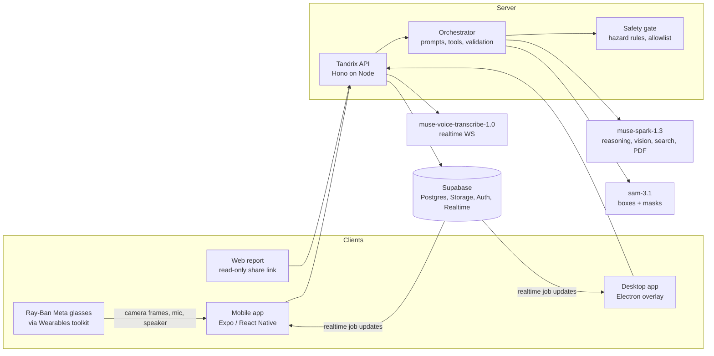

# Tandrix — Technical Architecture

**Status:** Hackathon MVP architecture.
**Stance:** one backend and one job model; thin surface clients; every AI output schema-validated; every result carries its source.

## 1. System overview



## 2. Stack

| Layer | Choice | Why |
|---|---|---|
| Monorepo | pnpm workspaces (+ Turborepo if builds get slow) | Three clients share contracts and core logic. |
| Mobile | Expo (React Native, TypeScript), expo-router, dev client | Camera, mic, on-device TTS (`expo-speech`), and native modules for the glasses SDK. |
| Glasses | Meta Wearables Device Access Toolkit wrapped as an Expo native module, iOS and Android | Native SDKs on both; no web path for the camera. |
| Desktop | Electron + React + Vite, macOS only for the MVP | Transparent always-on-top click-through overlay, `globalShortcut`, `desktopCapturer`. |
| Web report | Small React page served by the API (or Vite static) | Share link for managers/experts without install. |
| API | Hono on Node 22, deployed to Fly.io or Railway | Light, TypeScript, supports WebSockets (needed for voice proxy). |
| Validation | Zod (shared `packages/contracts`) | Inputs, model output, tool arguments. |
| Data | Supabase: Postgres, Storage (private buckets), Auth, Realtime | Realtime powers device handoff; storage for photos and manuals. |
| Reasoning / vision | `muse-spark-1.3` via Responses API | Image, video, audio, PDF in; tool calling; structured output; search grounding; 1M context. |
| Screen pointing / control | `muse-spark-1.3` (or `muse-wonder-1.0`) with the computer-use tool | Returns actions with x,y in screenshot pixels. **Show me** mode renders only `move` as a pointer; **Do it for me** mode executes allowed actions through the input driver. |
| Desktop input driver | `@nut-tree/nut-js` (or a small native helper) in the Electron main process | Synthetic mouse/keyboard; needs macOS Accessibility permission. |
| Segmentation | `sam-3.1` via Responses API | Text prompt → boxes and masks for all matches; point/box prompts; video tracking. |
| Speech to text | `muse-voice-transcribe-1.0`, realtime WebSocket | Streaming transcription with endpointing. |
| Text to speech | On-device: `expo-speech` (mobile), Web Speech API (desktop/Electron) | Meta has no TTS model. |
| Tests | Vitest (packages, API), Maestro or Detox smoke (mobile, optional), Playwright (web report) | |

Model IDs live in environment config. Verify current IDs, pricing and rate limits on https://dev.meta.ai/docs/models before the build (as of Oct 2026: base URL `https://api.meta.ai/v1`, bearer auth; Spark 1.3 at $1.25 / $4.25 per million input/output tokens).

## 3. Repository layout

```text
apps/
  mobile/            # Expo app: capture, step loop, parts check, record mode
    modules/glasses/ # Expo native module wrapping the Wearables toolkit
  desktop/           # Electron: overlay window, panel window, hotkey, capture
  api/               # Hono server: routes, orchestrator, voice proxy, web report
packages/
  contracts/         # Zod schemas + TS types shared by all apps
  core/              # job/step state machine, status rules, safety rules
  ai/                # Meta API client, prompts, output parsing, SAM helpers
supabase/
  migrations/        # schema + row-level security
fixtures/
  demo-pump/         # nameplate, parts, manual pages, reference images
docs/
```

## 4. Domain model

| Entity | Key fields | Notes |
|---|---|---|
| `Asset` | id, owner_id, category (`equipment` \| `software`), make, model, serial?, nameplate_evidence_id, created_at | A physical machine or a piece of software. Manuals attach by model key, not by asset. |
| `Manual` | id, asset_model_key, source_type (`search` \| `upload`), source_url, storage_key, page_count, created_at | Cached per model so the next job reuses it. |
| `Procedure` | id, asset_model_key, source_type (`manual` \| `expert_recording` \| `generic`), author_id, status (`draft` \| `published`), version, title, created_at | Reusable template of steps. |
| `ProcedureStep` | id, procedure_id, order, surface (`physical` \| `desktop`), title, instruction, reason?, part_spec_ids[], caution?, hazard_tags[], verification (`photo` \| `screen` \| `user_confirm` \| `measurement`), expected_state, measurement? (quantity, unit, target, tolerance), citation (`manual` page/figure \| `expert_recording` timestamp \| `generic`), reference_image_key? | |
| `PartSpec` | id, procedure_id, part_number, name, qty, description | Parts list for parts check. |
| `Job` | id, owner_id, asset_id, procedure_id, title, status (`active` \| `completed` \| `stopped`), current_step_id, active_surface, control_mode (`show` \| `do`), language, created_at, updated_at | The session shared across devices. `control_mode` resets to `show` on every new job. |
| `JobStep` | id, job_id, procedure_step_id, status, status_evidence_id, started_at, note? (skip/block reason), updated_at, updated_by_surface | Status: `todo`, `in_progress`, `needs_attention`, `user_confirmed`, `verified`, `blocked`, `skipped`. |
| `Evidence` | id, job_id, job_step_id?, kind (`photo` \| `screenshot` \| `video` \| `audio` \| `document`), surface (`phone` \| `glasses` \| `desktop`), storage_key, mime_type, byte_size, width?, height?, captured_at, uploaded_at? (set when the API confirms the file), deleted_at? | Upload types and size limits per kind: `uploadLimits` in `@tandrix/contracts`. |
| `Detection` | id, evidence_id, label, part_spec_id?, box, mask_key?, confidence, confirmed_by_user (null until reviewed), corrected_label? | SAM geometry + Spark labelling. |
| `PointerTarget` | surface, evidence_id, kind (`point` \| `box` \| `mask`), geometry, label, confidence | One format for screen pointer and camera highlight. |
| `Check` | id, job_step_id, evidence_id, result (`pass` \| `fail` \| `not_verifiable`), reason, what_to_show_next?, created_at | Only `pass` can set `verified`. |
| `PartsCheck` | id, job_id, evidence_ids[], results[] (part_spec_id, status `found` \| `possible` \| `missing`, detection_ids[]), created_at | |
| `SafetyConfirmation` | id, job_step_id, gate, confirmed_by, surface, confirmed_at | Gates: `isolate_power`, `release_pressure`, `lock_rotation`, `cool_down`, `lifting_plan`, `chemical_ppe`. |
| `ShareLink` | id, job_id, token_hash, expires_at | Read-only report. Not yet in contracts (T23). |
| `Event` | id, job_id, type, surface?, payload (JSON), created_at | Audit trail and report timeline. Types: `EventType` in `@tandrix/contracts`. |

The Zod schemas in `@tandrix/contracts` are the source of truth for these shapes; this table summarises them.

### Status rules (`packages/core`)
- `verified` only from a `Check` with `pass` on evidence captured after the step started.
- `user_confirmed` for steps whose verification is `user_confirm`/`measurement`, or when a photo check is `not_verifiable` and the user confirms.
- A step with hazard tags cannot enter `in_progress` without matching `SafetyConfirmation`s.
- Missing parts from `PartsCheck` set dependent steps to `blocked` until resolved or overridden with a reason.

## 5. API surface

All routes authenticated (Supabase JWT), Zod-validated, and scoped to the owner.

| Route | Method | Purpose |
|---|---|---|
| `/jobs` | POST / GET | Create / list jobs |
| `/jobs/:id` | GET | Job with steps, evidence metadata, current step |
| `/jobs/:id/evidence` | POST | Create pending evidence (type/size checked) and return a signed upload URL for `<owner>/<job>/<id>.<ext>` in the private `evidence` bucket |
| `/jobs/:id/evidence/:evidenceId/complete` | POST | Confirm the file arrived; checks the stored size and type, deletes and rejects a disallowed file, then sets `uploaded_at` |
| `/jobs/:id/evidence` | GET | Confirmed evidence for the job, each with a 5-minute signed read URL |
| `/jobs/:id/asset/identify` | POST | Nameplate photo (uploaded evidence on the job) → Spark reading, or `unavailable` (model down, billing, rate limit, unreadable plate) so the app falls back to typing |
| `/jobs/:id/asset` | PUT | Save the confirmed equipment: creates the asset, links the job and records `asset_identified` with its source (`model`, `model_edited`, `manual`) in one transaction |
| `/jobs/:id/manual/search` | POST | The cached manual for the job's make and model, or search candidates, each with a short-lived token signed to the user, URL and model |
| `/jobs/:id/manual/fetch` | POST | Download a searched candidate (token required) through the SSRF-safe fetcher; stored as a shared manual |
| `/jobs/:id/manual/upload`, `…/upload/:uploadId/complete` | POST | Signed upload URL for a PDF, then the API checks it is a readable PDF (else removes it); private to the user |
| `/jobs/:id/manual/from-photos` | POST | Combine uploaded page photos, in order, into a private PDF |
| `/jobs/:id/manual/:manualId/url` | GET | Short-lived signed URL to open the manual |
| `/procedures/generate` | POST | Manual (or nothing) → draft procedure with citations |
| `/procedures/from-recording` | POST | Expert video → draft procedure (P1) |
| `/jobs/:id/parts-check` | POST | Photo(s) → found/possible/missing |
| `/jobs/:id/steps/:stepId/highlight` | POST | Frame → `PointerTarget`s for the step's parts |
| `/jobs/:id/steps/:stepId/check` | POST | Check photo/screenshot → `Check` |
| `/jobs/:id/steps/:stepId` | PATCH | User status changes (confirm, skip, safety gate) |
| `/jobs/:id/screen/ask` | POST | Desktop: screenshot + question → reply text + `PointerTarget` |
| `/jobs/:id/handoff` | POST | Set active surface; realtime notifies devices |
| `/jobs/:id/report` | GET | Report JSON; `/r/:token` serves the web page |
| `/voice/stream` | WS | Proxies client audio to Muse Voice Transcribe; key stays server-side |
| `/health` | GET | No secrets |

Errors: every database error is converted to an `Error` before it leaves a repo (Supabase returns plain objects, which Hono would not route to the error handler), and a safety net converts anything else thrown. A token whose account no longer exists gets 401 on writes; the phone signs out on any 401.

Long calls (procedure generation, recording) return a job ID and stream progress over Supabase Realtime.

## 6. AI pipelines

### 6.1 Identify asset
1. Spark reads the nameplate photo → structured `{make, model, serial, ratings[], confidence}`.
2. Spark with search grounding: find the manufacturer manual/spec PDF for that model → candidate URLs.
3. API downloads the PDF (allowlisted content types, size limit), stores it, records the source URL.

### 6.2 Procedure from manual
1. Send the manual (PDF via Files API, or page images) + asset + task ("assembly", "seal replacement") to Spark.
2. Structured output: `PartSpec[]` and `ProcedureStep[]`, each step with `citation` (page, figure) and `hazard_tags`.
3. Validate; reject steps without citation unless `source_type = generic`.
4. Crop referenced figures as `reference_image_key` where a page/figure is cited.

### 6.3 Highlight parts on a frame
1. Downscale frame (e.g. long edge 1280 px).
2. Call SAM 3.1 with a short noun phrase per part in the step ("impeller", "O-ring").
3. If several matches, ask Spark (frame + boxes numbered + step context) which box is the part.
4. Return `PointerTarget`s with mask/box and confidence. If nothing found, return a hint for a better angle.

### 6.4 Parts check
1. SAM with generic prompts ("mechanical part", plus each part name) to get all objects.
2. Spark gets the frame with numbered boxes + `PartSpec[]` and assigns parts → `found` / `possible` / `missing`.
3. User corrections are stored on `Detection.confirmed_by_user`.

### 6.5 Step check
- Input: check photo, step `expected_state`, reference image.
- Spark returns `{result: pass|fail|not_verifiable, reason, what_to_show_next?}`.
- Prompt rule: `not_verifiable` for anything a photo can't show (torque, internal fit, electrical).

### 6.6 Teach me this screen (desktop)
1. Electron captures the display under the cursor at native resolution, downsizes to a fixed width, keeps the scale factor.
2. Send screenshot + transcript + job step to Spark with the computer-use tool enabled; instruct it to use only `move` for pointing, plus a structured reply text.
3. **Show me** mode: any `click`/`type`/other action is not executed; it is rendered as a pointer target with the instruction ("Click here"). **Do it for me** mode: see §6.6a.
4. Map coordinates back with the scale factor and the display's origin (multi-monitor).
5. Fallback if accuracy is poor (decided by the day-1 spike): model names the control → OS accessibility API (macOS AX / Windows UIA) finds its frame; or SAM on the screenshot to snap to the nearest element box.

### 6.6a Do it for me (desktop control, P1)
- Mode is held in the Electron main process (`control_mode: show | do`), defaults to `show`, resets per job, and is mirrored to the job for the audit trail.
- Observe → act loop per the Meta computer-use guide: one action batch at a time, fresh screenshot after each, no batching across page loads or dialogs.
- Every proposed action passes a deterministic **action guard** in `packages/core` before execution:
  - allowed types: `move`, `click`, `double_click`, `scroll`, `type`, `keypress`, `wait`, `screenshot`; `drag` and system-level key combos (e.g. quit, lock, force-quit) need confirm.
  - sensitive classifier (rule-based on the model's stated intent + target label + OCR of the target region): payment, send, delete, password/secret fields, system/security settings, installers → require explicit confirm.
  - rate limit and max actions per user request.
- Before acting: pointer animates to target, caption announces the action, ~1 s cancel window.
- Interrupts: Esc, the hotkey, or any physical mouse/keyboard input from the user immediately stops the loop (input driver watches for non-synthetic events).
- Every executed action is an `Event` with before/after screenshot evidence.
- Model-proposed actions never bypass the guard; the model cannot change the mode.

### 6.7 Record mode (P1)
- Upload the video (Files API); Spark returns steps with timestamps, parts mentioned, cautions heard.
- Extract keyframes at timestamps (ffmpeg on server) as reference images.
- Saved as a `draft` procedure for the expert to edit.

### 6.8 Rules for every model call
- Minimal context: current step, asset, procedure summary, last few events.
- Structured output with Zod schema; one repair retry; else safe fallback text.
- Text inside images, manuals and screenshots is data. System prompt states it can't change rules or tools.
- Log prompt/response IDs and token counts, not raw media.

## 7. Clients

### Mobile (Expo)
- Sign-in: Supabase email code (6 digits; custom email template) with the session in the Keychain/Keystore via `expo-secure-store`, chunked because sessions can exceed one entry. A password sign-in exists only on the local stack.
- Routing: Expo Router with `Stack.Protected` for signed-in vs signed-out screens.
- Monorepo: Metro resolves React, React Native and native UI libraries from the app only, so `@tandrix/ui` never brings a second copy.
- `expo-camera` (or `react-native-vision-camera` if we need frame access) for capture.
- Overlay masks drawn with `react-native-skia` on the captured frame.
- Voice: record PCM 16 kHz chunks → `/voice/stream`; push-to-talk button and volume-key option.
- Offline: cache current procedure, manual pages and reference images; queue evidence uploads.

### Glasses (Wearables toolkit)
- Expo native module (Swift/Kotlin) exposing: connect, start/stop camera stream, capture photo, stream state events.
- Frames feed the same capture pipeline as the phone camera, with `surface: glasses`.
- Audio uses the glasses as a Bluetooth headset (mic in, speaker out) for push-to-talk and TTS.
- Ray-Ban Display lens output is P2.
- Needs the Wearables Developer Center access and a supported country; confirm on day 0.

### Desktop (Electron)
- Overlay: full-screen transparent, always-on-top, click-through `BrowserWindow` per display; draws the pointer buddy and caption.
- Panel: small window (tray/menu bar) with current job, steps, mic state, stop.
- Hotkey: hold-to-talk via `globalShortcut` (plus a native key-up helper if needed).
- Capture: `desktopCapturer`; macOS Screen Recording permission flow.
- Subscribes to job realtime for handoff.

## 8. Security and privacy

- Meta API key, Supabase service key only on the API server.
- Supabase access model: clients (`authenticated`) can only **read** their own rows (RLS) and get no write privileges at all; every write goes through the API with the secret key, which checks ownership and applies `@tandrix/core` rules. `anon` has no table access. Supabase no longer grants API roles anything on new tables, so each migration grants explicitly (see the init migration).
- Multi-row writes run as one transaction in a database function callable only by `service_role` (e.g. `create_job` writes the job and its `job_created` event).
- Private storage buckets, short-lived signed URLs.
- File type and size limits on every upload; manual downloads only from search results, PDF/image only.
- Manual fetch (SSRF): https on port 443 only, no credentials in URLs; every hop's DNS answers checked against private, loopback, link-local (incl. 169.254.169.254), CGNAT, multicast and IPv6 ULA ranges; the connection pinned to the checked address; redirects re-checked (max 3); 60 MB and 20 s total caps; `%PDF-` and a full parse required. Clients can only submit URLs carrying an HMAC token from their own recent search (`TOKEN_SIGNING_SECRET`).
- Share links: random token, hashed in DB, expiry, read-only, revocable.
- No raw media in logs. Delete job deletes evidence objects.
- Desktop executes model-proposed actions only in user-enabled **Do it for me** mode, and only after the deterministic action guard (§6.6a); otherwise it renders pointer targets only.
- Safety rules in `packages/core` are deterministic; model output can add hazard tags but never remove them.

## 9. Performance targets

| Action | Target |
|---|---|
| Highlight parts on frame | < 4 s |
| Step check | < 5 s |
| Desktop ask → pointer + first audio | < 4 s |
| Nameplate → manual found | < 20 s with progress shown |
| Procedure generation | < 60 s with progress; cached per model after first run |
| Handoff to desktop | < 3 s |

Downscale images before sending, stream progress, cache manuals and procedures per model, and prefetch the next step's highlights.

## 10. Testing

- Unit: status rules, safety gates, Zod schemas, coordinate mapping, parts matching.
- Integration: each AI pipeline against fixture images with recorded model responses.
- Accuracy spikes: SAM on the demo pump parts; screen pointing on the demo desktop app.
- E2E rehearsal: the full demo script on real hardware, five runs in a row.
- Negative: denied permissions, blurry photo, no manual found, offline, model timeout, malformed output, prompt injection text on a label or screen, wiring request.
