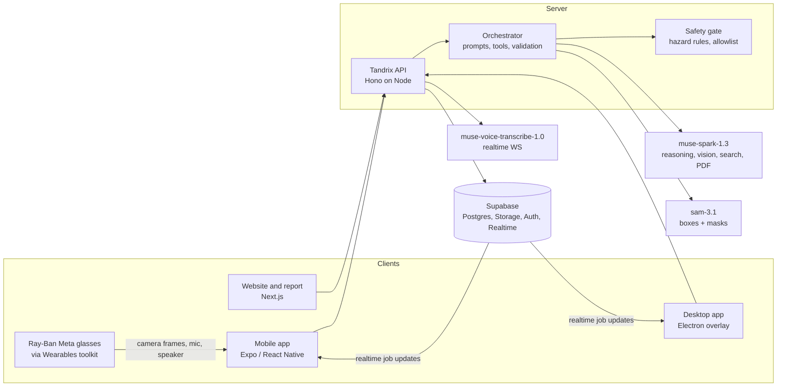

# Tandrix — Technical Architecture

**Status:** current as of 30 October 2026.

One backend and one job model; thin clients on each surface; every model output is schema-validated, and every result carries its source.

## 1. System overview



## 2. Stack

| Layer | Choice | Why |
|---|---|---|
| Monorepo | pnpm workspaces (+ Turborepo if builds get slow) | Three clients share contracts and core logic. |
| Mobile | Expo (React Native, TypeScript), expo-router, dev client | Camera, mic, on-device TTS (`expo-speech`), and native modules for the glasses SDK. |
| Glasses | Meta Wearables Device Access Toolkit wrapped as an Expo native module, iOS and Android | Native SDKs on both; no web path for the camera. |
| Desktop | Electron + React + Vite, macOS only | Transparent always-on-top click-through overlay, `globalShortcut`, `desktopCapturer`, hidden off-screen windows for Tandrix's own browser. |
| Website | Next.js 16 (App Router) + Tailwind CSS v4, themed from the design system's tokens | The marketing site and the read-only report at `/r/[token]`. |
| API | Hono on Node 22, deployed to Fly.io or Railway | Light, TypeScript, supports WebSockets (needed for voice proxy). |
| Validation | Zod (shared `packages/contracts`) | Inputs, model output, tool arguments. |
| Data | Supabase: Postgres, Storage (private buckets), Auth, Realtime | Realtime powers device handoff; storage for photos and manuals. |
| Reasoning / vision | `muse-spark-1.3` via Responses API | Image, video, audio, PDF in; tool calling; structured output; search grounding; 1M context. |
| Screen pointing / control | `muse-spark-1.3` (or `muse-wonder-1.0`) with the computer-use tool | Returns actions with x,y in screenshot pixels. **Show me** mode renders only `move` as a pointer; **Do it for me** mode executes allowed actions through the input driver. |
| Desktop input driver | `tandrix-input`, a native Swift helper (CGEvent) run by the Electron main process | Synthetic mouse and keyboard, scrolls as phased trackpad gestures, reports password fields; needs macOS Accessibility. |
| Wake word | `tandrix-wake`, a native Swift helper (Apple on-device speech recognition) | "Hey Tandrix" heard on the Mac only; optional on-device voiceprint. |
| Segmentation | `sam-3.1` via Responses API | Text prompt → boxes and masks for all matches; point/box prompts; video tracking. |
| Speech to text | `muse-voice-transcribe-1.0`, file endpoint in push-to-talk mode | The phone records one turn (hold to talk) as WAV and the API transcribes it. Chosen over the realtime WebSocket for the MVP: no native PCM streaming module, and a held button already delimits the turn; the cost is no live partial words while speaking. |
| Text to speech | Kokoro (open model, `kokoro-js`) on the API, with common lines pre-voiced; the device's best installed voice as the fallback | Meta has no TTS model; Kokoro sounds natural and runs on our own server. |
| Tests | Vitest (packages, API, desktop), Maestro end-to-end flows (mobile, iOS simulator) | |

Model IDs live in environment config. Verify current IDs, pricing and rate limits on https://dev.meta.ai/docs/models before the build (as of Oct 2026: base URL `https://api.meta.ai/v1`, bearer auth; Spark 1.3 at $1.25 / $4.25 per million input/output tokens).

## 3. Repository layout

```text
apps/
  mobile/            # Expo app: projects, capture, step loop, parts check, handoff, report
  desktop/           # Electron: panel, overlay, Show me, Do it for me, background agents
    native/          # Swift helpers: tandrix-input (input driver), tandrix-wake (wake word)
  api/               # Hono server: routes, model pipelines, voice, early access
  web/               # Next.js: marketing site and shared report (/r/[token])
packages/
  contracts/         # Zod schemas and TS types shared by every app
  core/              # step status, safety gates, action guard, assistant rules
  ai/                # Meta API client, prompts, output parsing, background agents
  ui/                # @tandrix/ui: design tokens and components (web and native)
supabase/
  migrations/        # schema and row-level security
fixtures/
  demo-pi5/          # a real kit (Raspberry Pi 5 case) for live checks
docs/
```

## 4. Domain model

| Entity | Key fields | Notes |
|---|---|---|
| `Asset` | id, owner_id, category (`equipment` \| `software`), make, model, serial?, nameplate_evidence_id, created_at | A physical machine or a piece of software. Manuals attach by model key, not by asset. |
| `Manual` | id, asset_model_key, source_type (`search` \| `upload`), source_url, storage_key, page_count, created_at | Cached per model so the next job reuses it. |
| `Procedure` | id, asset_model_key, source_type (`manual` \| `expert_recording` \| `generic`), author_id, status (`draft` \| `published`), version, title, created_at | Reusable template of steps. |
| `ProcedureStep` | id, procedure_id, order, surface (`physical` \| `desktop`), title, instruction, reason?, part_spec_ids[], caution?, hazard_tags[], verification (`photo` \| `screen` \| `user_confirm` \| `measurement`), expected_state, measurement? (quantity, unit, target, tolerance), citation (`manual` page/figure \| `expert_recording` timestamp \| `generic`), reference_image_key? | |
| `PartSpec` | id, procedure_id, part_number, name, qty, description | Parts list for parts check. |
| `Job` | id, owner_id, asset_id, procedure_id, title, status (`active` \| `completed` \| `stopped`), current_step_id, active_surface, control_mode (`show` \| `do`), language, created_at, updated_at | The session shared across devices. `control_mode` resets to `show` on every new job. |
| `JobStep` | id, job_id, procedure_step_id, status, status_evidence_id, started_at, note? (skip/block reason), updated_at, updated_by_surface | Status: `todo`, `in_progress`, `needs_attention`, `user_confirmed`, `verified`, `blocked`, `skipped`. |
| `Evidence` | id, job_id, job_step_id?, kind (`photo` \| `screenshot` \| `video` \| `audio` \| `document`), surface (`phone` \| `glasses` \| `desktop`), storage_key, mime_type, byte_size, width?, height?, captured_at, uploaded_at? (set when the API confirms the file), deleted_at? | Upload types and size limits per kind: `uploadLimits` in `@tandrix/contracts`. |
| `Detection` | id, evidence_id, label, part_spec_id?, box, mask? (SVG outline + raster size), confidence, confirmed_by_user (null until reviewed), corrected_label? (only with confirmed_by_user true) | SAM geometry + Spark labelling. |
| `PointerTarget` | surface, evidence_id, kind (`point` \| `box` \| `mask`), geometry, label, confidence | One format for screen pointer and camera highlight. A mask is the SAM raster traced to an SVG path (`decodeMaskToSVGPath`) in raster pixels, drawn scaled onto its box. |
| `Check` | id, job_step_id, evidence_id, result (`pass` \| `fail` \| `not_verifiable`), reason, what_to_show_next?, created_at | Only `pass` can set `verified`. |
| `PartsCheck` | id, job_id, evidence_ids[], results[] (part_spec_id, status `found` \| `possible` \| `missing`, detection_ids[]), created_at | |
| `SafetyConfirmation` | id, job_step_id, gate, confirmed_by, surface, confirmed_at | Gates: `isolate_power`, `release_pressure`, `lock_rotation`, `cool_down`, `lifting_plan`, `chemical_ppe`. |
| `ShareLink` | id, job_id, token_hash, expires_at, revoked_at? | Read-only report link; at most ten per job. |
| `Event` | id, job_id, type, surface?, payload (JSON), created_at | Audit trail and report timeline. Types: `EventType` in `@tandrix/contracts`. |

The Zod schemas in `@tandrix/contracts` are the source of truth for these shapes; this table summarises them.

### Status rules (`packages/core`)
- `verified` only from a `Check` with `pass` on evidence captured after the step started.
- `user_confirmed` for steps whose verification is `user_confirm`/`measurement`, or when a photo check is `not_verifiable` and the user confirms.
- A step with hazard tags cannot enter `in_progress` without matching `SafetyConfirmation`s.
- Missing parts from `PartsCheck` set dependent steps to `blocked` until resolved or overridden with a reason.

## 5. API surface

All routes authenticated (Supabase JWT), Zod-validated, and scoped to the owner.

| Route | Method | Purpose |
|---|---|---|
| `/jobs` | POST / GET | Create / list jobs |
| `/jobs/:id` | GET | Job with steps, evidence metadata, current step |
| `/jobs/:id/evidence` | POST | Create pending evidence (type/size checked) and return a signed upload URL for `<owner>/<job>/<id>.<ext>` in the private `evidence` bucket |
| `/jobs/:id/evidence/:evidenceId/complete` | POST | Confirm the file arrived; checks the stored size and type, deletes and rejects a disallowed file, then sets `uploaded_at` |
| `/jobs/:id/evidence` | GET | Confirmed evidence for the job, each with a 5-minute signed read URL |
| `/jobs/:id/asset/identify` | POST | Nameplate photo (uploaded evidence on the job) → Spark reading, or `unavailable` (model down, billing, rate limit, unreadable plate) so the app falls back to typing |
| `/jobs/:id/asset` | PUT | Save the confirmed equipment: creates the asset, links the job and records `asset_identified` with its source (`model`, `model_edited`, `manual`) in one transaction |
| `/jobs/:id/manual/search` | POST | The cached manual for the job's make and model, or search candidates, each with a short-lived token signed to the user, URL and model |
| `/jobs/:id/manual/fetch` | POST | Download a searched candidate (token required) through the SSRF-safe fetcher; stored as a shared manual |
| `/jobs/:id/manual/upload`, `…/upload/:uploadId/complete` | POST | Signed upload URL for a PDF, then the API checks it is a readable PDF (else removes it); private to the user |
| `/jobs/:id/manual/from-photos` | POST | Combine uploaded page photos, in order, into a private PDF |
| `/jobs/:id/manual/:manualId/url` | GET | Short-lived signed URL to open the manual |
| `/jobs/:id/procedure` | POST | The job's manual (or, with `allowGeneric`, nothing) → Spark draft → `normalizeDraft` rules → procedure, parts, steps and job steps saved by `save_procedure` in one transaction; 409 if the job already has steps |
| `/procedures/from-recording` | POST | Expert video → draft procedure (P1) |
| `/jobs/:id/parts-check` | POST | One uploaded photo of the laid-out parts → SAM finds the objects, Spark assigns them to the parts list (refs, never ids) → every listed part found, possible or missing (unreported counts as missing) → `core.applyPartsCheck` blocks the steps that need a missing part (`blocked_by = parts`, note "Missing part: …") and lifts parts blocks that no longer apply. `save_parts_check` saves the check, its detections and the blocks together |
| `/jobs/:id/parts-check/:partsCheckId/parts/:partSpecId` | PATCH | The user's correction to one part's status; blocks re-applied in the same transaction (`correct_parts_check`) |
| `/jobs/:id/steps/:stepId/highlight` | POST | An uploaded photo on the job → highlights for up to three of the step's parts (each saved as a `Detection`), the parts not found, and a framing hint; `unavailable` when the model can't help (the app lists the parts by number) |
| `/jobs/:id/detections/:detectionId` | PATCH | The user's verdict on a highlight: `confirmed`, `wrong`, or `other_part` (relabelled to another part of the procedure) |
| `/jobs/:id/steps/:stepId/check` | POST | An uploaded photo (or, for a screen step, screenshot) of the finished step → Spark judges it against the expected state → `core.transitionStep` (`check`): pass → verified on that photo, fail → needs attention with the reason, not verifiable → stays in progress and the user may confirm it. The rules run first (step active, photo taken after the step started, a photo/screen step), so a call that can only be turned down never reaches the model. `record_check` saves the check and the status together |
| `/jobs/:id/steps/:stepId/actions` | POST | `start`, `confirm_safety`, `confirm_done` (with a measured value for measurement steps), `skip` (with a reason) or `reopen`. The API applies `@tandrix/core` `transitionStep` and saves through `confirm_safety_gate` / `apply_step_transition` (one transaction each, with an event). A rule saying no is a `rejected` answer with its code and, for gates, the gates still to confirm; a step changed on another device meanwhile is a 409. The sending app names itself in `X-Tandrix-Surface` (`phone` by default) for the audit trail; checks take the surface from their evidence |
| `/jobs/:id/screen/ask` | POST | Desktop: screenshot evidence + question → reply text + `PointerTarget` + the model's proposed actions (drawn only) |
| `/screen/ask` | POST | Desktop, outside a job: the screenshot travels inline and isn't kept; same answer as above |
| `/screen/do`, `/screen/do/continue` | POST | Do it for me: one computer-use turn each (§6.6a) |
| `/screen/background` | POST | A background task (§6.6b): one stateless step; answers, or asks the Mac to run named tools and send their outputs back. 60 a minute per user |
| `/pairing` | POST | Signed out (the Mac): `{deviceName}` → an 8-character code (Crockford base32, 40 bits) for the QR, a poll token only the Mac keeps, and the expiry (2 min) |
| `/pairing/lookup`, `/pairing/approve` | POST | Signed in (the phone): `{code}` → which Mac it is; approving ties the pairing to the user, once |
| `/pairing/:id` | GET | The Mac, with `X-Pairing-Token`: `pending`, `expired` (also once used), or `approved` with a one-time sign-in token hash, minted by the admin API (`generateLink` magic link, no email sent) and exchanged by the Mac with `verifyOtp`; the pairing is used up as it's handed over |
| `/jobs/:id/handoff` | POST | `{to, stepId?}`: sets the job's active device and current step and records a `handoff` event (who sent it, to where, which step) in one transaction (`hand_off_job`). The Mac hears the event over Realtime; both apps hear job and step changes |
| `/jobs/:id/report` | GET | Report JSON; `/r/:token` serves the web page |
| `/voice/transcribe` | POST | One push-to-talk turn (multipart WAV, mono 16-bit, 16 or 24 kHz, under a minute; optional keywords) → Muse Voice Transcribe file endpoint in `PUSH_TO_TALK` mode. The WAV is checked before any model call; a tap without speech is `unclear` without one. Key stays server-side |
| `/jobs/:id/steps/:stepId/ask` | POST | What was said or typed on a step: wiring and live work refused first (`core.refusalForRequest`), then commands (`core.parseVoiceCommand`: next, back, repeat, show me again, start, done, skip [because …], stop) returned for the app to carry out, then questions answered by Spark in the step's context |
| `/health` | GET | No secrets |

Errors: every database error is converted to an `Error` before it leaves a repo (Supabase returns plain objects, which Hono would not route to the error handler), and a safety net converts anything else thrown. A token whose account no longer exists gets 401 on writes; the phone signs out on any 401.

Writing a job's steps runs in the background. `POST /jobs/:id/procedure/start` claims the job's one run (`procedure_runs`, `claim_procedure_run`) and answers at once; the work carries on in the API process, and `GET /jobs/:id/procedure/run` reports `writing`, `created` or `unavailable`. Both apps poll every 2 s through `waitForProcedure` (`@tandrix/core`), riding out a dropped connection. Starting again finds the same run, so reopening the app or retrying never writes or pays twice. A run still marked running after 8 minutes was lost to a restart or deploy, and can be claimed again. Polling rather than Realtime: the table has no client policies, and it survives a Realtime disconnect. Record mode (about 10 s) is still one waiting request.

## 6. AI pipelines

### 6.1 Identify asset
1. Spark reads the nameplate photo → structured `{make, model, serial, ratings[], confidence}`.
2. Spark with search grounding: find the manufacturer manual/spec PDF for that model → candidate URLs.
3. API downloads the PDF (allowlisted content types, size limit), stores it, records the source URL.

### 6.2 Procedure from manual
Manuals up to 36 MB go inline (`input_file` with base64 `file_data`; the API caps inline files at 50 MB). Larger ones go through the Files API with a one-hour expiry and are deleted right after the call. The model reads text from the first 100 PDF pages and images from the first 50.

Before saving, `normalizeDraft` (@tandrix/core) renumbers steps, drops unknown part refs, labels any citation to a page the manual doesn't have as Generic, turns a measurement step without a value into a user confirmation, and merges rule-detected hazard tags. Generated procedures are `draft` and private to their author.

1. Send the manual (PDF via Files API, or page images) + asset + task ("assembly", "seal replacement") to Spark.
2. Structured output: `PartSpec[]` and `ProcedureStep[]`, each step with `citation` (page, figure) and `hazard_tags`.
3. Validate; reject steps without citation unless `source_type = generic`.
4. Step visuals (P7): `GET /jobs/:id/steps/:stepId/visuals` returns the user's reference photo (`job_steps.reference_evidence_id`, set with `PUT`/`DELETE …/reference`), the cited manual page and the step's latest photo or screenshot, as signed URLs. Manual pages are rendered to JPEG on first use (pdf.js and @napi-rs/canvas in a worker thread with a 20 s limit, so an untrusted PDF can't block the API), stored in the manuals bucket and recorded in `manual_pages`. Cropping to the cited figure is not done yet.

### 6.3 Highlight parts on a frame
1. Downscale frame (e.g. long edge 1280 px).
2. Call SAM 3.1 with a short noun phrase per part in the step ("impeller", "O-ring").
3. If several matches, ask Spark (frame + boxes numbered + step context) which box is the part.
4. Return `PointerTarget`s with mask/box and confidence. If nothing found, return a hint for a better angle.

### 6.4 Parts check
1. SAM with generic prompts ("mechanical part", plus each part name) to get all objects.
2. Spark gets the frame with numbered boxes + `PartSpec[]` and assigns parts → `found` / `possible` / `missing`.
3. User corrections are stored on `Detection.confirmed_by_user`.

### 6.5 Step check
- Input: check photo, step `expected_state`, reference image (the user's reference photo, else the cited manual page, labelled to the model as which it is). Steps with `verification: screen` (done in software) are checked on a screenshot instead, with their own prompt (`prompts.checkScreen`); the route takes only a screenshot for them and only a photo for photo steps.
- Spark returns `{result: pass|fail|not_verifiable, reason, what_to_show_next?}`.
- Prompt rule: `not_verifiable` for anything a photo can't show (torque, internal fit, electrical), or a screen can't show (a setting on another page, a change only visible on the equipment).
- On the Mac the panel offers the current desktop step (the job's current step if it's done in software, else the first unfinished one): start it, "Check my screen" (the panel steps aside for a fresh screenshot of the display under the cursor, then returns with the `CheckResult`, also spoken), and "I've done it" after a not-verifiable answer. The phone shows screen steps with a notice to finish them on the Mac.

### 6.6 Teach me this screen (desktop)
1. Electron captures the display under the cursor at native resolution, downsizes to 1280 px wide (JPEG), keeps the geometry (`ScreenGeometry`: image size, display origin and size in points). On the hotkey it captures before the panel appears; a typed question puts the panel away first. The screenshot is uploaded as job evidence (`screenshot`, `desktop`) while the question is transcribed.
2. `POST /jobs/:id/screen/ask` sends the screenshot + transcript + the job's current step to Spark with the computer-use tool (`tools: [{type: "computer"}]`, one turn, `store: false`). The prompt asks for one action at the control's centre plus one or two spoken sentences. Actions are validated against `DesktopAction` (coordinates rounded); the first action with a position becomes the `PointerTarget` (point geometry, labelled "Click here", "Scroll here"…), and points outside the screenshot are dropped. Safety checks are logged, never acknowledged. Model failures answer `unavailable`.
3. **Show me** mode: any `click`/`type`/other action is not executed; it is rendered as a pointer target with the instruction ("Click here"). **Do it for me** mode: see §6.6a.
4. Map coordinates back with the scale factor and the display's origin (multi-monitor).
5. Fallback if accuracy is poor (decided by the day-1 spike): model names the control → OS accessibility API (macOS AX / Windows UIA) finds its frame; or SAM on the screenshot to snap to the nearest element box.

### 6.6a Do it for me (desktop control, P1)
- Mode is held in the Electron main process (`control_mode: show | do`), defaults to `show` at every launch, and is mirrored to the job for the audit trail. With it off, Tandrix offers to do a task and waits for a spoken or clicked yes; asked directly ("do it for me"), it switches for that task and back.
- Observe → act loop per the Meta computer-use guide: one action batch at a time, fresh screenshot after each, no batching across page loads or dialogs.
- Every proposed action passes a deterministic **action guard** in `packages/core` before execution:
  - allowed types: `move`, `click`, `double_click`, `scroll`, `type`, `keypress`, `wait`, `screenshot`; `drag` and system-level key combos (e.g. quit, lock, force-quit) need confirm.
  - sensitive classifier (rule-based on the model's stated intent + target label + OCR of the target region): payment, send, delete, password/secret fields, system/security settings, installers → require explicit confirm.
  - rate limit and max actions per user request.
- Before acting: pointer animates to target, caption announces the action, ~1 s cancel window.
- Interrupts: Esc, the hotkey, or any physical mouse/keyboard input from the user immediately stops the loop (input driver watches for non-synthetic events).
- Every executed action is an `Event` with before/after screenshot evidence.
- Model-proposed actions never bypass the guard; the model cannot change the mode.
- Built: `POST /screen/do` and `/screen/do/continue` run one model turn each (`packages/ai/src/doing.ts`). Long chains of `previous_response_id` turns grow slower (8 → 14 s measured), so the Mac's runner (`apps/desktop/src/renderer/lib/screen-task.ts`) makes each turn a fresh call carrying a short text memory of what it has done (`memory`, up to 40 lines), followed by one chained turn (`/continue`, `store: true`) so the model keeps its own intent. The runner also checks its work before saying done, notices circling (similar replies and click-only turns: nudge, then stop and ask) and steps that changed nothing, and takes corrections said mid-task ("no, Thursday"). The continue session is HMAC-signed to the user, response, call and turn number, and a task stops at `DO_MAX_TURNS` (200). Batches are up to eight actions; scrolls are posted as a phased trackpad gesture in ~40 px steps. The panel only relays; the Electron main process holds the mode (Show me at every launch; Do it for me needs Accessibility and a ConfirmDialog), validates each batch against the contracts, runs `core.guardAction` per action, asks in a native alert for anything sensitive and for the model's `pending_safety_checks` (never auto-acknowledged), announces each action with the pointer for 450 ms, and posts input through `tandrix-input` (`apps/desktop/native/input/main.swift`, CGEvent, events tagged `TAND`; it also reports password fields through the accessibility API, so typing there is refused). Any key, click or mouse movement from the user (the uiohook watcher, ignoring input within 250 ms of Tandrix's own), Esc or ⌃⌥Space stops the task; the presence pill shows "Tandrix is in control" throughout.

### 6.6b Background agents (desktop)
- Screen jobs share one mouse and keyboard, so they run one at a time (`apps/desktop/src/renderer/lib/agents.ts`, the task board). Everything else starts at once, beside them, up to three background tasks in parallel. While a screen job runs, `core.whileBusy` routes what's said: stop or a correction goes to that job, a question about the screen is answered by looking (no pointer), a look-up or question of fact goes to a background agent, and only another screen job queues.
- A background agent (`packages/ai/src/background.ts`) is Muse Spark with web search and, from the Mac, typed tools (`MAC_TOOLS` in `@tandrix/contracts`): `calendar_add_event`, `calendar_list_events`, `reminders_add`, `notes_create`, `mail_draft`, `files_list` and `browse`. The loop is stateless (`store: false`): each `/screen/background` call carries the task, the Mac's local time and every tool call so far with its output; the answer is either the next calls or the final SPOKEN/DETAIL reply. At most 8 rounds.
- The Mac runs each tool without its screen, mouse or keyboard (`apps/desktop/src/main/mac-tools.ts`): a fixed AppleScript per tool, the model's words passed only as `on run argv` arguments (never script text), dates split into numbers before AppleScript sees them, apps started with `launch` (never brought forward). Nothing sends, pays or deletes: mail is saved as a draft. macOS asks the user once per app (Automation).
- `browse` uses Tandrix's own browser (`apps/desktop/src/main/browser-session.ts`): a hidden, off-screen `BrowserWindow` per task on one saved profile (`persist:tandrix-browser`), driven by the same computer-use runner and the same action guard as the screen, but with Electron's in-window input events, so the real pointer never moves. ⌘L, typing and Return open an address; the page's URL goes into each turn's memory. Downloads, pop-up windows and permission requests are refused. The user signs in to sites once in a visible window on that profile (Settings → Tandrix's browser); their own browsers are never touched.

### 6.7 Record mode (P1)
- Upload the video (Files API); Spark returns steps with timestamps, parts mentioned, cautions heard.
- Extract keyframes at timestamps (ffmpeg on server) as reference images.
- Saved as a `draft` procedure for the expert to edit.

### 6.8 Rules for every model call
- Minimal context: current step, asset, procedure summary, last few events.
- Structured output with Zod schema; one repair retry; else safe fallback text.
- Text inside images, manuals and screenshots is data. System prompt states it can't change rules or tools.
- Log prompt/response IDs and token counts, not raw media.

## 7. Clients

### Mobile (Expo)
- Sign-in: Supabase email code (6 digits; custom email template) with the session in the Keychain/Keystore via `expo-secure-store`, chunked because sessions can exceed one entry. A password sign-in exists only on the local stack.
- Routing: Expo Router with `Stack.Protected` for signed-in vs signed-out screens.
- Monorepo: Metro resolves React, React Native and native UI libraries from the app only, so `@tandrix/ui` never brings a second copy.
- `expo-camera` (or `react-native-vision-camera` if we need frame access) for capture.
- Overlay masks drawn with `react-native-skia` on the captured frame.
- Voice: hold the mic on the StepCard to record a 16 kHz mono WAV turn (`expo-audio`) → `/voice/transcribe` → `/ask`; replies are spoken in Tandrix's voice (Kokoro from the API, `expo-speech` as the fallback) and shown in `VoiceTranscript`. Android can't write WAV with `expo-audio`; it needs PCM streaming or server-side conversion when Android resumes.
- Offline (`apps/mobile/src/offline`): each job's last-seen detail (steps, procedure, safety confirmations) is cached in the app's documents, so steps stay readable. Step actions (start, gates, done, skip, reopen) and photos (evidence, and check photos with "check when sent") go into a persistent queue, sent oldest first when the API can be reached (every 20 s while anything waits, on returning to the app, and on any successful load); a send that can't reach the API stops the queue so later work never overtakes earlier work. Actions carry `occurredAt`, which the API honours within a day, so a step started offline keeps its real start time and photos taken after it still count. While queued, the phone applies the same `core.transitionStep` rules locally and shows the step as Pending; anything the server turns down on sync is shown plainly. Not offline: reading a nameplate, finding a manual, writing steps and highlighting parts need an answer now and say so. Manual PDFs and reference images aren't cached yet.

### Glasses (Wearables toolkit)
- Expo native module (Swift/Kotlin) exposing: connect, start/stop camera stream, capture photo, stream state events.
- Frames feed the same capture pipeline as the phone camera, with `surface: glasses`.
- Audio uses the glasses as a Bluetooth headset (mic in, speaker out) for push-to-talk and TTS.
- Ray-Ban Display lens output is P2.
- Needs the Wearables Developer Center access and a supported country; confirm on day 0.

### Desktop (Electron)
- Overlay: full-screen transparent, always-on-top (`screen-saver` level, on every Space and over full-screen apps), click-through, non-focusable `BrowserWindow` per display, rebuilt when displays change; draws the pointer buddy and caption. Coordinates (`apps/desktop/src/main/displays.ts`): screenshot pixels → global points via the capture's display bounds and image size; global points → the overlay of the display that shows them, clamped on screen.
- Panel window: frameless, from the menu bar. It shows the job the phone handed over (if any), with its current step and steps list.
- Renderer security: `contextIsolation`, `sandbox`, no Node; the preload exposes only `window.tandrix` (`src/shared/bridge.ts`), and the main process answers IPC only from its own windows, with argument checks. No new windows or navigation. Built apps load pages from `app://tandrix` (a privileged scheme confined to the renderer folder), so the API allows that origin by name and the CSP (`connect-src` only the API and Supabase) means something.
- Sign-in: Supabase email code as on the phone; the session is stored by the main process, encrypted with `safeStorage` (Keychain key), never in `localStorage`.
- Talking: hold ⌥⌘ in any app to talk and let go to ask (a uiohook key watcher, which needs Accessibility); the ⌃⌥Space `globalShortcut` is tap to listen and tap again to ask; Esc (taken only while listening) cancels. The panel's mic button is hold to talk. The panel records 16 kHz mono WAV with an AudioWorklet (`/voice/transcribe`, as on the phone) and speaks replies in Tandrix's voice (Kokoro from the API, the best installed macOS voice as the fallback). Pages get the microphone only (no camera or other permissions), and only Tandrix's own windows.
- Capture: `desktopCapturer`; macOS Screen Recording permission flow.
- Wake word: `tandrix-wake` (`native/wake`) listens with Apple's on-device recognition only and acts on partial results after a 0.9 s pause, so "Hey Tandrix, open Calendar" arrives whole. Optional voiceprint ("Only answer my voice", `native/wake/voiceprint.swift`, `src/main/voiceprint.ts`): three setup phrases give 24 numbers (the mean and spread of MFCCs over voiced frames); each wake phrase is cut by the recogniser's word timings and compared by a distance scaled by how voices differ, which cancels the microphone's colouring. Kept only on the Mac (`voiceprint.json`, 0600), deletable; a filter for the TV and other people, not a lock.
- Panel: the main screen is for asking and the task board; Settings holds Do it for me, the wake word and voice, Tandrix's browser sign-in, the user's name and the account. The assistant hook lives on the page, so opening Settings never stops a task.
- Realtime (Supabase, RLS applies): the panel listens for new `handoff` events sent to the desktop (not for `jobs.active_surface`, which also changes when the Mac starts a step) and opens the job, posts a macOS notification ("{Job}: step N is ready", click opens the panel) and shows the incoming `HandoffBanner` until the step is opened or finished. Both apps reload the open job on `jobs`/`job_steps` changes (bursts folded, and once on subscribe to catch up). The phone offers "Continue on Mac" on steps done on a computer (they have no phone primary action) and shows "Waiting on your Mac" on the step and the job until the user takes it back. Realtime reports SUBSCRIBED slightly before its change feed is live; the catch-up reload covers that gap.

## 8. Security and privacy

- Meta API key, Supabase service key only on the API server.
- Supabase access model: clients (`authenticated`) can only **read** their own rows (RLS) and get no write privileges at all; every write goes through the API with the secret key, which checks ownership and applies `@tandrix/core` rules. `anon` has no table access. Supabase no longer grants API roles anything on new tables, so each migration grants explicitly (see the init migration).
- Multi-row writes run as one transaction in a database function callable only by `service_role` (e.g. `create_job` writes the job and its `job_created` event).
- Private storage buckets, short-lived signed URLs.
- File type and size limits on every upload; manual downloads only from search results, PDF/image only.
- Manual fetch (SSRF): https on port 443 only, no credentials in URLs; every hop's DNS answers checked against private, loopback, link-local (incl. 169.254.169.254), CGNAT, multicast and IPv6 ULA ranges; the connection pinned to the checked address; redirects re-checked (max 3); 60 MB and 20 s total caps; `%PDF-` and a full parse required. Clients can only submit URLs carrying an HMAC token from their own recent search (`TOKEN_SIGNING_SECRET`).
- Share links: random token, hashed in DB, expiry, read-only, revocable.
- Pairing a Mac: codes and poll tokens are stored only as SHA-256 hashes, last 2 minutes, are approved once and used once (each change is one guarded update). The QR never contains the poll token, so someone who sees the code can't collect the session. Rate limits (in memory, one API process): creating codes 10 a minute per client address, look-ups and approvals 10 a minute per user, polls 120 a minute per pairing. The phone shows the name the Mac reported and warns to approve only a Mac in use right now: that name is the Mac's claim, so a QR from someone else's screen remains a phishing risk the warning has to cover. Behind a proxy, the client address must come from the platform's client-IP header (set when deploying, T32).
- No raw media in logs. Delete job deletes evidence objects.
- Desktop executes model-proposed actions only in user-enabled **Do it for me** mode, and only after the deterministic action guard (§6.6a); otherwise it renders pointer targets only.
- Background agents act only through the fixed tools of §6.6b; tool arguments are data, never script; Tandrix's browser shares nothing with the user's browsers and passes the same action guard (paying, sending or deleting asks).
- The voiceprint and wake-word audio never leave the Mac; no audio is kept.
- Safety rules in `packages/core` are deterministic; model output can add hazard tags but never remove them.

## 9. Performance targets

| Action | Target |
|---|---|
| Highlight parts on frame | < 4 s |
| Step check | < 5 s |
| Desktop ask → pointer + first audio | < 4 s |
| Nameplate → manual found | < 20 s with progress shown |
| Procedure generation | < 60 s with progress; cached per model after first run |
| Handoff to desktop | < 3 s |

Downscale images before sending, stream progress, cache manuals and procedures per model, and prefetch the next step's highlights.

## 10. Testing

- Unit: status rules, safety gates, Zod schemas, coordinate mapping, parts matching.
- Integration: each AI pipeline against fixture images with recorded model responses.
- Accuracy checks: SAM on the demo kit's parts; screen pointing and Do it for me on a synthetic app in headless Chrome; Tandrix's browser on a live site.
- End to end: Maestro flows on the iOS simulator against real models; the full demo on real hardware before release.
- Negative: denied permissions, blurry photo, no manual found, offline, model timeout, malformed output, prompt injection text on a label or screen, wiring request.
