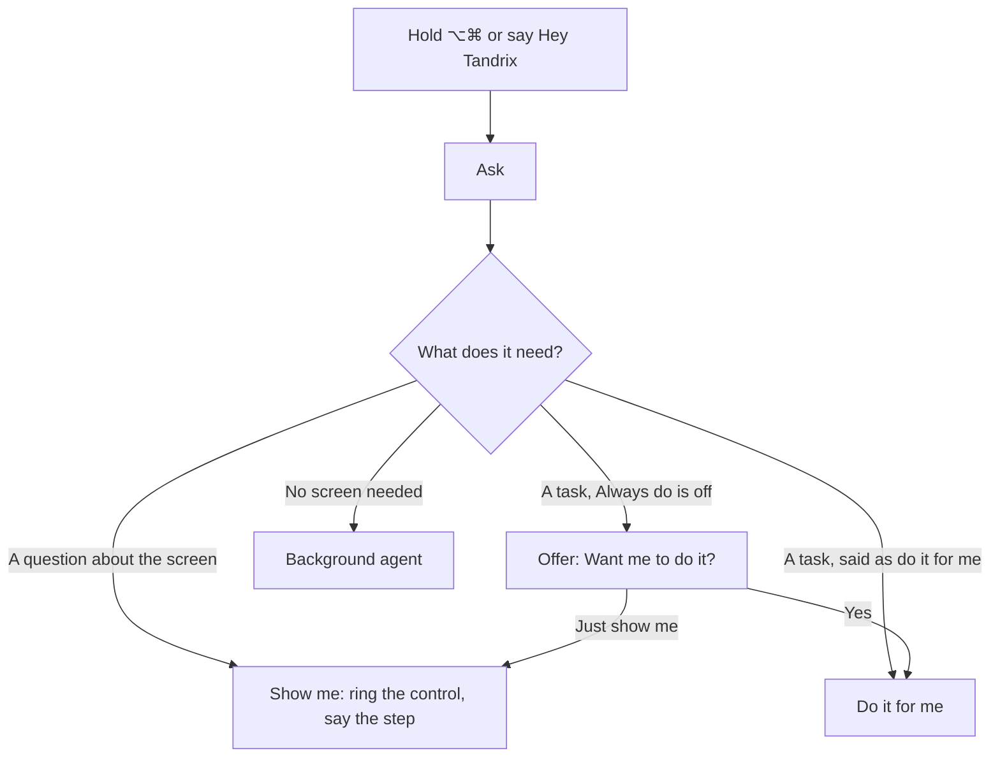
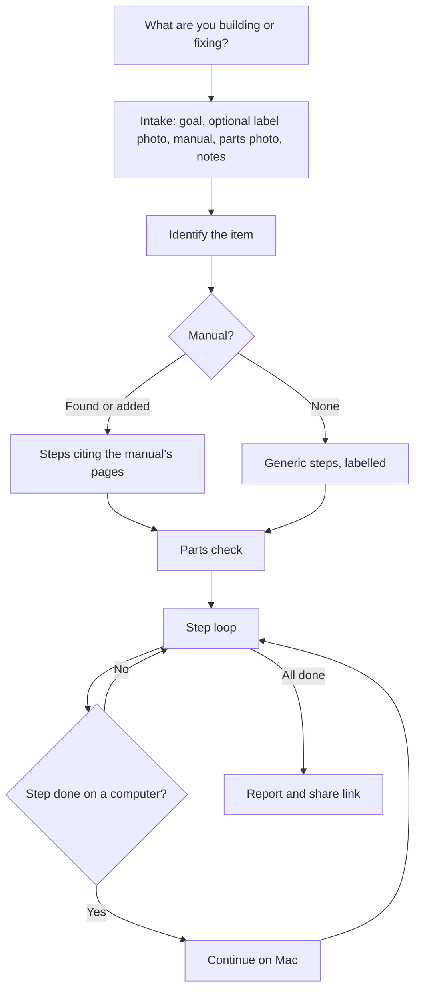
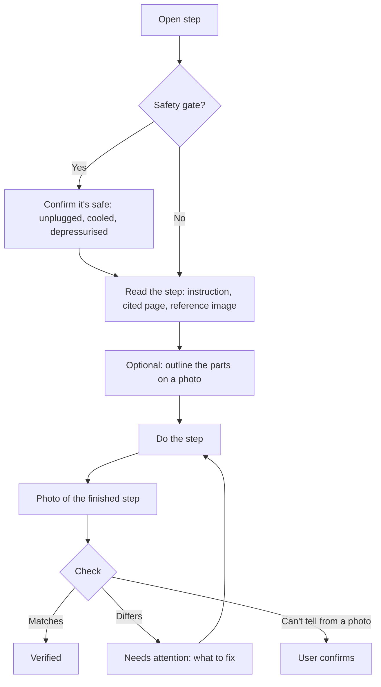

# Tandrix — User Flows

**Status:** current as of 30 October 2026. Requirements are in the [PRD](PRD.md).

## 1. First run

**iPhone.** A short introduction (what Tandrix does; it checks your work with photos; it talks you through), why it needs the camera and microphone, then sign in with an emailed code. Home asks **What are you building or fixing?** with examples and lists recent projects. Settings has **Sign in a Mac**.

**Mac.** Tandrix lives in the menu bar. Signed out, the panel shows a QR: scanning it with the phone (or typing its code in **Sign in a Mac**) signs the Mac in; email works too. First-run setup asks for Screen Recording and the microphone, then invites a first question with ⌥⌘ held.

## 2. Asking on the Mac

- **Show me.** The pointer rings the control and the reply is spoken and shown in the presence pill at the top of the screen. "Teach me …" gives one step per turn; "next" moves on.
- **Do it for me.** The pill says Tandrix is in control. Each action: the pointer moves to the target, says what it's doing, acts, and looks again. Paying, sending, deleting, passwords and security settings stop for a confirm. Moving the mouse, typing or Esc stops it. When finished, it checks the result and says what it did.
- **Background agent.** It answers by voice when ready and lists the task, with its full answer, on the panel's task board. It may add a calendar event, a reminder or a note, save an email draft, list files, or use a website in Tandrix's own hidden browser.

**While a screen task runs**, what the user says is routed:

| Said | What happens |
|---|---|
| "Stop" | The task stops; control is back at once. |
| A correction ("no, Thursday the 13th") | The running task is steered. |
| A question about the screen | Answered by looking, without taking the pointer. |
| A look-up or question of fact | A background agent starts now. |
| Another task on the screen | Queued next ("I've only got the one mouse"). |

## 3. A project on the iPhone

Intake shows each stage as it runs and resumes from a stopped stage. A missing part from the parts check holds the steps that need it until it's marked as here.

## 4. The step loop

Voice works throughout: "next", "repeat", "show me again", "what's this?", "skip because …", "stop", and any question about the step.

## 5. Handoff

1. A step done on a computer shows **Continue on Mac** on the phone.
2. The Mac shows a notification ("Step 5 is ready") and opens the step in the panel.
3. The user starts it and asks **Check my screen**; a screenshot verifies it.
4. The phone shows "Waiting on your Mac" and turns the step Verified as soon as the Mac checks it. Either device can take the project back.

## 6. Settings on the Mac

Opened from the gear in the panel header; a page of its own.

| Group | What's there |
|---|---|
| Doing things for you | Always do things without asking first (asks once, with a plain confirmation) |
| Listening | Wake word; Teach Tandrix my voice (three phrases), Only answer my voice, Delete my voice |
| Tandrix's browser | Sign in to sites the background agents should use |
| You | What Tandrix calls you |
| Account | Signed-in email; Sign out |

## 7. Errors and recovery

| Situation | What Tandrix does |
|---|---|
| Camera, microphone or screen access denied | Says why it's needed and how to allow it; typing and the photo picker still work. |
| Blurry or dark photo | Asks for another with a specific hint. |
| A part isn't found in the photo | Says so plainly and lists the parts by number. |
| No signal on the phone | Steps stay readable; actions and photos queue and send later, shown as Pending. |
| A model call fails | Says it couldn't, plainly; nothing is guessed. |
| The control isn't on screen | Points at the way to it (a menu, a tab, scrolling) instead of guessing. |
| Do it for me makes no progress | Tries a different approach, then stops and asks what to do. |
| Hazardous request (wiring, live work) | Declines that guidance and suggests a qualified person. |
