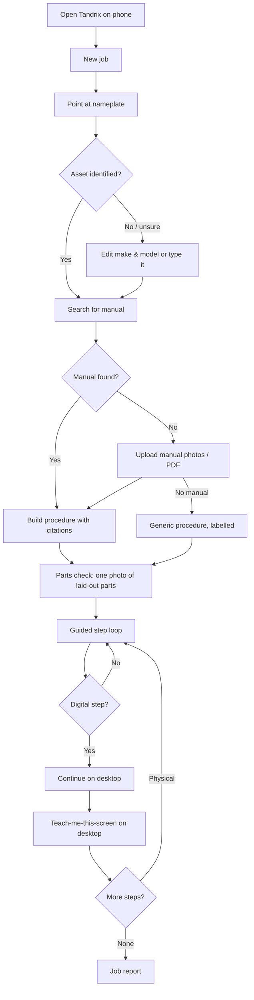
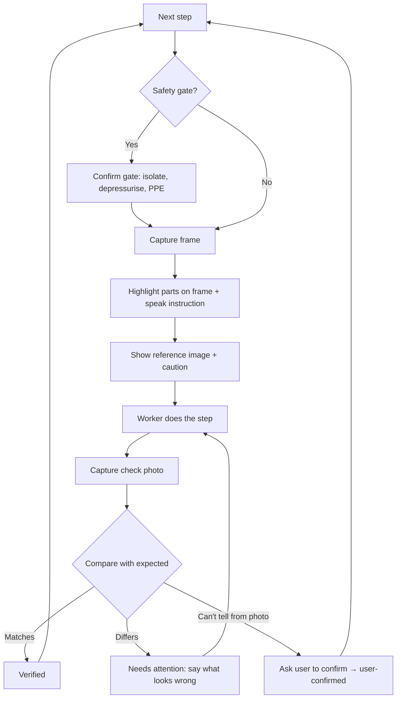

# Tandrix — User Flows

## 0. First run and home

- **Phone:** three short cards (what Tandrix does on site; it checks your work with photos; it talks you through hands-free), why it needs the camera and microphone, then sign in. Home asks **"What are you building or fixing?"** with examples ("Assemble a home server rack", "Replace a pump seal", "Mount a TV on drywall"), offers **Scan a nameplate** for equipment, and lists recent projects.
- **Mac:** sign in with the phone's QR (or email), then setup: allow Screen Recording, allow the microphone, try the hotkey on any app ("How do I …?"). The panel's home is asking: a question box, the mic, the hotkey reminder and the last answers. A job card appears only when the phone hands one over.

## 1. End-to-end job (demo spine)

A phone project can also start from a goal with no equipment: the goal goes straight to "Build procedure" (Generic unless a manual is added).

## 2. Guided step loop (phone / glasses)

Voice commands available at every point: "next", "repeat", "show me again", "what's this?", "I'm stuck", "skip", "stop".

## 3. Teach me this screen (desktop)

1. User holds the hotkey and speaks ("How do I set the pressure limit in this app?"). Release sends.
2. Desktop captures the active screen, sends screenshot + transcript + job context.
3. Tandrix replies by voice with the first step; the pointer flies to the target and shows a label.
4. User clicks. Tandrix re-captures (on hotkey or auto after a short delay) and checks the screen changed as expected.
5. Repeat until done; the step in the job is set to verified (screen evidence) or user-confirmed.

**Do it for me mode.** The user switches from **Show me** to **Do it for me** in the desktop panel or by voice ("just do it"). First time per job, a plain confirmation: *"Clicking this allows Tandrix to control your device."* Then, per action:

1. Pointer moves to the target and the caption says what it's about to do ("Clicking **Save**").
2. Short pause (about 1 s); moving the mouse, typing or pressing Esc pauses Tandrix and hands control back.
3. Tandrix acts, re-captures, and checks the result before the next action.
4. Sensitive actions (pay, send, delete, passwords, system/security settings, installs) always stop for an explicit confirm.

An indicator stays on screen the whole time Tandrix is in control.

## 4. Device handoff

- Phone reaches a step tagged `surface: desktop`, or the user taps **Continue on desktop**.
- Desktop app (signed in to the same account) shows a notification: "Job: Pump P-100 assembly — step 9 ready." One click opens it.
- Phone shows "Waiting on desktop" and still lets the user go back to physical steps.
- First-time pairing: desktop shows a QR code; scan with the phone to link.

## 5. Parts check

1. "Lay the parts out on a clear surface, not touching if possible."
2. Capture one photo (or two for large sets).
3. Tandrix outlines each object and labels it against the parts list: ✓ found, ? possible match, ✗ missing.
4. User taps any label to correct it or mark "not sure".
5. Result is saved as evidence. Missing parts become a blocker on the steps that need them.

## 6. Record mode

1. Senior tech chooses **Record a procedure**, names the asset model.
2. Records the job on phone or glasses, narrating ("now I fit the mechanical seal, carbon face toward the impeller").
3. Tandrix produces a draft: steps, keyframes, parts mentioned, cautions heard.
4. Expert edits, deletes, reorders, then publishes.
5. Future jobs on that model offer: "Use procedure recorded by A. Rivera (expert) or the manufacturer manual?"

## 7. Glasses

- Pair glasses in the phone app (Meta AI app + Tandrix permission).
- Job runs on the phone; the glasses are the camera, mic and speaker.
- "Hey, next" style voice control; capture on voice command or the phone/glasses button.
- Highlights are shown on the phone screen (and on the lens for Ray-Ban Display, P2); speech carries the instruction.

## 8. Screens

| Surface | Screen | Purpose |
|---|---|---|
| Phone | Home | Recent jobs, new job, record procedure |
| Phone | Capture | Camera, capture button, mic, flash, retake |
| Phone | Asset | Identified make/model, manual source, edit |
| Phone | Parts check | Annotated photo, list of found/missing |
| Phone | Step | Highlighted frame, instruction, reference image, caution, check button |
| Phone | Report | Steps, statuses, evidence, share |
| Desktop | Overlay | Pointer buddy and caption bubble over all apps |
| Desktop | Panel | Menu-bar panel: current job, step list, mic state, stop |
| Web | Shared report | Read-only job report for manager or expert |

## 9. Error and recovery

| Situation | Behaviour |
|---|---|
| Camera/mic denied | Explain why it's needed; offer photo picker and typed input. |
| Blurry / dark photo | Ask for retake with a specific hint (closer, more light, other angle). |
| Part not found in frame | "I can't find the impeller here. Try from the front." Numbered text fallback. |
| No signal | Use cached procedure; queue photos; mark checks "pending" until synced. |
| Model timeout or invalid output | One retry; then show the cached step text and continue. |
| Pointer target not visible | "Scroll down" or "open the Settings menu first" instead of guessing. |
| Hazardous request (wiring, live work) | Refuse that guidance, explain, suggest a qualified person. |

## 10. Demo script (3–5 min)

1. **Hook (15 s):** "Manuals don't come to site. Experts don't scale. Tandrix does."
2. **Identify (30 s):** point phone at the pump nameplate → model found → manual found with source link.
3. **Parts check (30 s):** one photo of laid-out parts → every part outlined, one missing O-ring flagged.
4. **Guided steps (75 s):** two to three steps with highlighted parts, spoken instructions, photo checks; one shows "needs attention" and gets corrected. At least one step done through the glasses.
5. **Handoff (45 s):** "Continue on desktop" → laptop opens the job → "Teach me this screen" → pointer guides the controller/monitoring setup.
6. **Report (30 s):** verified vs user-confirmed vs unresolved, with evidence, shared link.
7. **Close (15 s):** record mode teaser and the vision: one AI engineer across physical and digital.
